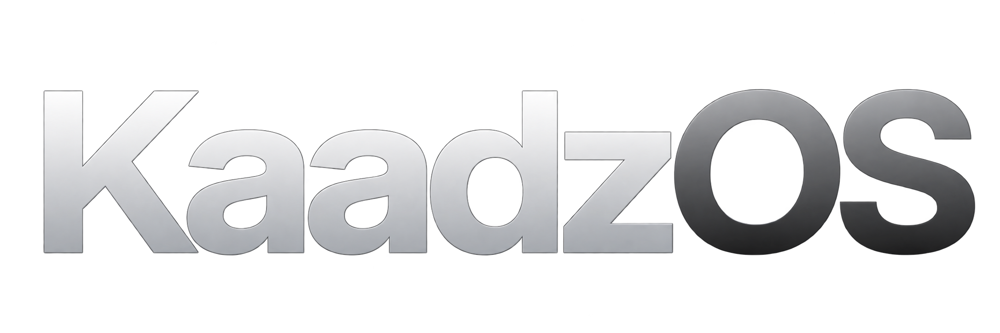

  

  ORGANIZATION DEFAULTS &nbsp;·&nbsp; SHARED ASSETS &nbsp;·&nbsp; COMMUNITY HEALTH

  <strong>The quiet room behind the noise.</strong> 
  One banner. One set of rules. Every repository reads from here.

  <a href="https://kaadzos.pages.dev">Website</a> &nbsp;·&nbsp;
  <a href="https://kaadzos.pages.dev/docs/">Manual</a> &nbsp;·&nbsp;
  <a href="https://github.com/KaadzOS/KaadzOS">Source</a> &nbsp;·&nbsp;
  <a href="https://github.com/KaadzOS/kaadzos-brand">Brand kit</a>

## Organization defaults

This is the quiet repository behind KaadzOS. It holds the public organization profile, the shared banner used at the top of every repository, and the community defaults that apply across the organization.

| Path | Purpose |
| --- | --- |
| [`profile/README.md`](profile/README.md) | The public profile, rendered at [github.com/KaadzOS](https://github.com/KaadzOS). |
| [`assets/kaadzoslogo.png`](assets/kaadzoslogo.png) | The wide shared banner used at the top of every README. |
| [`assets/kaadzos-mark.png`](assets/kaadzos-mark.png) | Square 512px org avatar; source in [`kaadzos-mark.svg`](assets/kaadzos-mark.svg). |
| [`assets/social-preview.png`](assets/social-preview.png) | 1200×630 social card; source in [`social-preview.svg`](assets/social-preview.svg). |
| [`assets/desktop.webp`](assets/desktop.webp) | Stable copy of the CI-captured desktop shot used by the social card. |
| [`LICENSE`](LICENSE) | The MIT licence for the organization's files. |
| [`CODE_OF_CONDUCT.md`](CODE_OF_CONDUCT.md) | Conduct expectations for project spaces. |
| [`SUPPORT.md`](SUPPORT.md) | Where to get help and what to include. |
| [`SECURITY.md`](SECURITY.md) | Private vulnerability reporting. |
| [`CONTRIBUTING.md`](CONTRIBUTING.md) | The constraints and checks to run before opening a pull request. |
| [`.github/ISSUE_TEMPLATE/`](.github/ISSUE_TEMPLATE/) | Bug and feature forms for all repositories. |
| [`PULL_REQUEST_TEMPLATE.md`](PULL_REQUEST_TEMPLATE.md) | The review checklist. |

## Elsewhere

- [KaadzOS source, releases and CI](https://github.com/KaadzOS/KaadzOS)
- [kaadzos-brand](https://github.com/KaadzOS/kaadzos-brand) — masthead, AMOLED palette and wallpaper
- [kaadzos-archive-keyring](https://github.com/KaadzOS/kaadzos-archive-keyring) — APT signing key and verification
- [kaadzos-website](https://github.com/KaadzOS/kaadzos-website) · [kaadzos-docs](https://github.com/KaadzOS/kaadzos-docs) · [kaadzos-pack-defs](https://github.com/KaadzOS/kaadzos-pack-defs)
- [kaadzos-packages](https://github.com/KaadzOS/kaadzos-packages) · [kaadzos-awesome](https://github.com/KaadzOS/kaadzos-awesome) — skeletons with stable addresses
- [Website](https://kaadzos.pages.dev) · [Manual](https://kaadzos.pages.dev/docs/) · [ISO mirror](https://iso.kaadzos.pages.dev)

Debian is a registered trademark of Software in the Public Interest, Inc. KaadzOS is an independent project.
