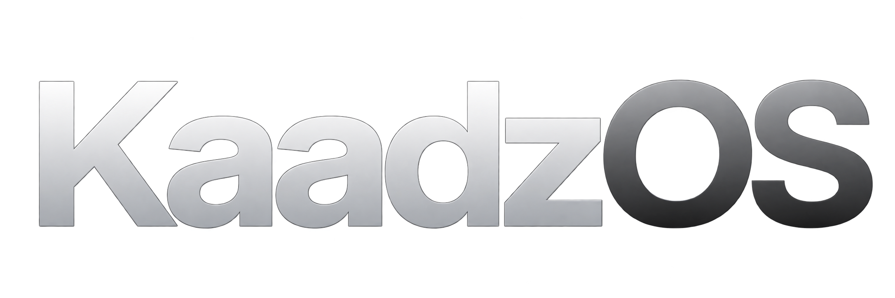

  

  DEBIAN 13 &nbsp;·&nbsp; SWAY / WAYLAND &nbsp;·&nbsp; AMD64

  <strong>A small operating system that proves itself.</strong> 
  Minimal by default. Black by design. Built and tested entirely in CI.

  <a href="https://kaadzos.pages.dev">Website</a> &nbsp;·&nbsp;
  <a href="https://kaadzos.pages.dev/docs/">Manual</a> &nbsp;·&nbsp;
  <a href="https://github.com/KaadzOS/KaadzOS/releases/latest">Download</a> &nbsp;·&nbsp;
  <a href="https://iso.kaadzos.pages.dev">ISO mirror</a>

---

## The project

KaadzOS is a minimal Debian 13 (trixie) live and installable distribution built around a hand-assembled Sway/Wayland desktop and a pure-black AMOLED interface. The base image stays small; heavier capabilities arrive through the `kaadzos` pack manager, one explicit install at a time.

The image that ships is the image that passed. CI builds the ISO in GitHub Actions, boots it under QEMU with BIOS and UEFI firmware, installs it unattended, and checks the first boot before a tag publishes a release.

## Repositories

| Repository | What lives there |
| --- | --- |
| [KaadzOS](https://github.com/KaadzOS/KaadzOS) | Live-build configuration, theme generator, pack manager, installer, CI harness and documentation. |
| [.github](https://github.com/KaadzOS/.github) | Organization profile, shared banner and community defaults. |

## Start here

- **Try it** — [download the latest ISO](https://github.com/KaadzOS/KaadzOS/releases/latest), with checksum and detached signature.
- **Read it** — the [website](https://kaadzos.pages.dev) and the [manual](https://kaadzos.pages.dev/docs/).
- **Build it** — the [source repository](https://github.com/KaadzOS/KaadzOS) and its GitHub Actions pipeline.
- **Extend it** — the [pack definitions](https://github.com/KaadzOS/KaadzOS/tree/main/packs) and the signed [APT archive](https://iso.kaadzos.pages.dev/apt/).

## What stays true

- **A small base.** APT recommends are off; optional software is a deliberate pack, not a default.
- **A strict palette.** True black, white type and a white accent; red belongs to errors.
- **Proof over promises.** Every release is booted and installed before it is published.
- **Debian underneath.** Stable packaging, signed archives and no bespoke runtime.

  Built in the open · Tested on every push · Released from a tag 
  Debian is a registered trademark of Software in the Public Interest, Inc. KaadzOS is an independent project.

